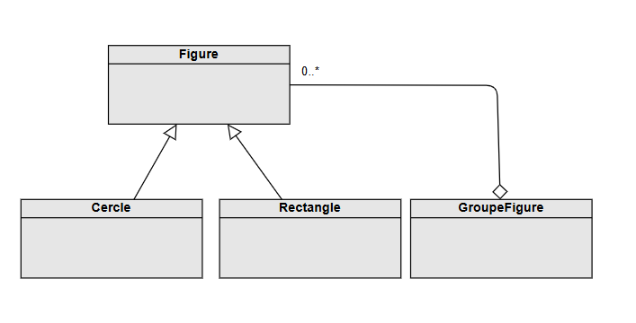
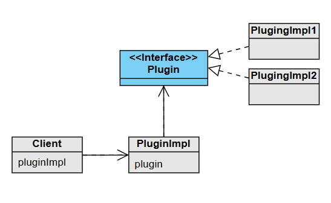
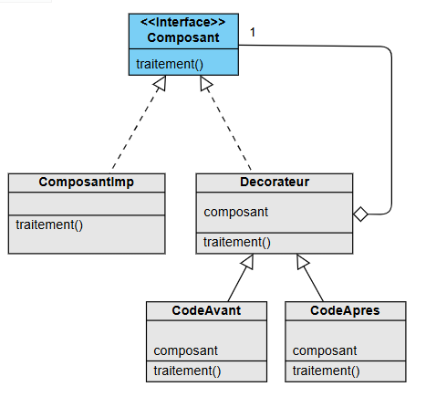
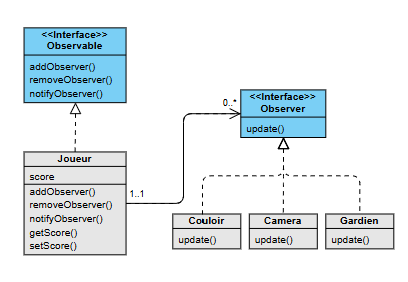
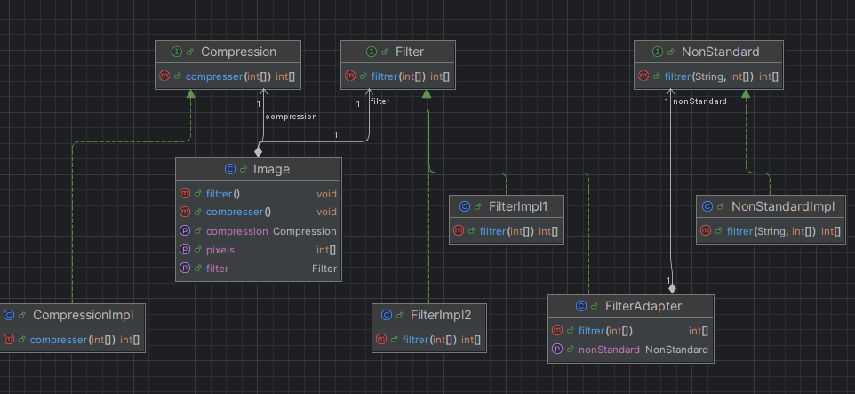
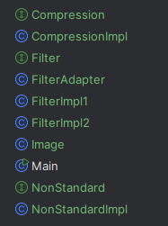
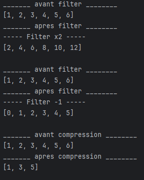
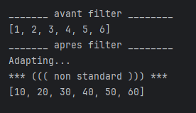

## TD - Designpatterns

### EXERCICE 1 

#### 1- Composite

#### 2- Strategy

#### 3- Décorateur

#### 4- Observer

### EXECICE 2

#### 1) diagramme de classes de ce Framework (Strategy et Adapter)

#### 2) Implémentation Java de ce Framework.

#### 3) Ecrire le code d’une application qui utilise ce Framework 

